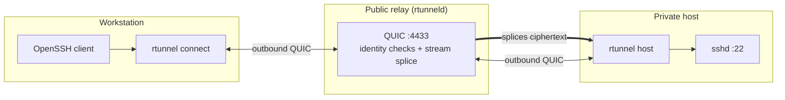

# rtunnel

`rtunnel` gives you SSH access to a machine behind NAT or a firewall without
opening an inbound port, configuring port forwarding, or owning a public IP.
Both machines dial out to a small relay over QUIC, and SSH stays end-to-end
between your OpenSSH client and the host's `sshd`.

- Connect with a 9-digit Device ID and a one-time access code.
- Confirm the connection with a matching 4-digit code on both machines.
- Persist an approved client so later connections need no code.
- Run the host as a service so it reconnects after a reboot.

## How it works



The relay authenticates both peers and authorizes the connection, but it never
holds SSH keys or sees plaintext. Only the host dials the local SSH port.

---

## 1. Deploy the relay

Use a small Linux server with a public IP. On that server:

```bash
curl -fsSL https://raw.githubusercontent.com/abiiranathan/rtunneld/main/scripts/install.sh \
  | sudo bash -s -- relay --listen 0.0.0.0:4433
```

The installer places `rtunneld` in `/usr/local/bin`, creates the relay identity
in `/var/lib/rtunnel`, installs a systemd unit, and starts it.

Open UDP port `4433` in the server firewall:

```bash
sudo ufw allow 4433/udp
```

Check that the service is running and watch the audit log:

```bash
sudo systemctl status rtunneld.service
sudo tail -f /var/lib/rtunnel/audit.log
```

Keep `/var/lib/rtunnel` safe. It contains the relay identity and the peer
database; losing it invalidates every Device ID and grant.

---

## 2. Prepare SSH on both machines

`rtunnel` only carries TCP. It does not install `sshd`, create users, or manage
SSH credentials, so set up ordinary SSH once before using it.

You need out-of-band access to the host for this step: its local console, a
cloud-provider console, cloud-init, or an existing SSH/LAN connection.

### On the host

Install and enable an SSH server.

```bash
# Debian / Ubuntu
sudo apt update && sudo apt install -y openssh-server
sudo systemctl enable --now ssh
```

```bash
# Fedora / RHEL
sudo dnf install -y openssh-server
sudo systemctl enable --now sshd
```

On macOS, enable **System Settings → General → Sharing → Remote Login**. On
Windows, install the OpenSSH Server optional feature and start the `sshd`
service.

Make sure the account you intend to use exists:

```bash
id <user>
```

### On the workstation

Create a key if you do not already have one:

```bash
ssh-keygen -t ed25519 -C "you@workstation"
```

Add the public key to the host account's `authorized_keys`. From the host
console, run as the target user and paste the key:

```bash
mkdir -p ~/.ssh
chmod 700 ~/.ssh
cat >> ~/.ssh/authorized_keys   # paste the .pub contents, then press Ctrl+D
chmod 600 ~/.ssh/authorized_keys
```

If the host is already reachable over SSH, you can do the same from the
workstation:

```bash
ssh-copy-id <user>@<host-address>
```

Test plain SSH before involving `rtunnel`:

```bash
ssh <user>@<host-address>
```

Once that works, `rtunnel` replaces the need to expose that address.

---

## 3. Install the client on both machines

Run this on the host **and** on the workstation:

```bash
curl -fsSL https://raw.githubusercontent.com/abiiranathan/rtunneld/main/scripts/install.sh \
  | bash -s -- client
```

When run as root the binary goes to `/usr/local/bin`; for a normal user it goes
to `~/.local/bin`. Restart your shell if the command is not found.

On Windows, run `scripts/install.ps1` from a checkout:

```powershell
.\scripts\install.ps1
```

---

## 4. Run setup on both machines

Run setup once on each machine, using the same relay address:

```bash
rtunnel setup --relay-host relay.example.com
```

If the relay uses a non-default port, add `--relay-port <port>`. Setup pins the
relay certificate with Trust On First Use and prints the fingerprint; pass
`--relay-fingerprint <sha256>` if you want to pin it explicitly instead.

Setup prints a permanent 9-digit Device ID. Note the host's Device ID; you need
it from the workstation.

---

## 5. Start the host and pair

On the host:

```bash
rtunnel host
```

It prints the Device ID and a single-use access code:

```text
=== rtunnel Host Daemon Running ===
Device ID:   482 913 077
Access Code: 834 291 (valid for 15 minutes)
Allowed target: 127.0.0.1:22
```

The relay consumes the code on first use. The host prints a replacement after
every pairing attempt, so always use the latest `Access Code:` line.

From the workstation, connect through OpenSSH with `rtunnel connect` as the
`ProxyCommand`:

```bash
ssh -o "ProxyCommand=rtunnel connect 482913077 --code 834291" <user>@482913077
```

`rtunnel connect` is a stdin/stdout bridge, not a shell. OpenSSH must launch it;
running it by itself only gives you a raw TCP connection.

The workstation prints a SAS code, and the host prompts its operator:

```text
Authentication Code (SAS): [4192]
Authorize this device? [1] Allow Once, [2] Always Allow, [3] Deny:
```

Both SAS values must match. Approval choices:

| Choice | Effect |
| --- | --- |
| `1` — Allow Once | Authorizes the client in relay memory for 5 minutes. Nothing is persisted. |
| `2` — Always Allow | Persists the grant in the relay database. Later connections need no code or prompt. |
| `3` — Deny | Rejects the request. |

After choosing **Always Allow**, write a permanent OpenSSH host entry:

```bash
rtunnel ssh-config 482913077 --write
ssh <user>@482913077
```

`rtunnel ssh-config --all --write` refreshes entries for every device granted to
this workstation.

---

## 6. Keep the host online

`rtunnel host` must keep running to serve connections. After at least one client
has **Always Allow**, install it as a service so it starts on boot:

```bash
sudo "$(command -v rtunnel)" --state-dir "$HOME/.config/rtunnel" service install
```

Use the exact state directory printed by setup or `rtunnel id`. Service managers
run as root, whose default configuration directory is not the one created by
your user-level `rtunnel setup`. Pass the full binary path as shown because
`sudo` may not include `~/.local/bin` in its `PATH`. Add `--target host:port` to
the install command if the service should dial something other than
`127.0.0.1:22`.

The service runs:

```bash
RUST_LOG=rtunnel_agent=warn rtunnel host
```

so normal operation is quiet and errors still reach the journal:

```bash
sudo journalctl -u rtunnel.service -f
```

A service has no interactive terminal and cannot answer new pairing prompts. To
add another device, stop the service, pair in the foreground, then start it
again:

```bash
sudo "$(command -v rtunnel)" service stop
rtunnel host
# approve the new device with "Always Allow", then press Ctrl+C
sudo "$(command -v rtunnel)" service start
```

On macOS the default state directory is
`$HOME/Library/Application Support/com.rtunnel.rtunnel`; on Windows it is
`%APPDATA%\rtunnel`. Use `rtunnel id` to confirm the path on any platform.

---

## 7. Day-to-day use

```bash
rtunnel id                      # local Device ID and state directory
rtunnel agents                  # reachable devices and their targets
rtunnel ssh-config --all --write
ssh <user>@482913077
```

---

## 8. Relay administration

### Web console

The relay serves a read-mostly operator console on `127.0.0.1:8080` by default.
It shows connected agents and their advertised targets, peers, grants, active
enrollment tokens, and recent audit events. From the console you can revoke a
peer, remove a grant, or revoke an enrollment token. Creating peers, tokens, or
grants stays on the host and in the CLI, so enrollment always goes through an
audited path.

The console binds to loopback. To use it from your workstation, forward the port
over SSH:

```bash
ssh -L 8080:127.0.0.1:8080 -N root@relay.example.com
```

Then open <http://127.0.0.1:8080>. Sign in with the admin token, which is
created on first install or start and stored with `0600` permissions:

```bash
sudo cat /var/lib/rtunnel/admin.token
```

Change the token by replacing that file or by setting `RTUNNEL_ADMIN_TOKEN` in
the service environment, then restart `rtunneld`.

To expose the console through a reverse proxy, terminate TLS at the proxy and
keep the relay's admin listener on loopback. Do not bind it to a public
interface. To disable the console entirely, add `--no-admin` to the `ExecStart`
line or pass `--no-admin` when running `rtunneld install`.

### Command line

Run these on the relay host:

```bash
sudo rtunneld peers-list
sudo rtunneld grant list
sudo rtunneld grant add <client> <host>
sudo rtunneld grant remove <client> <host>
sudo rtunneld revoke <peer>
```

Revoking a peer terminates its active sessions within 5 seconds and rejects
future handshakes. Prefer revocation over deleting rows so the audit trail stays
intact.

For token-based enrollment instead of interactive setup, create a one-time
token:

```bash
sudo rtunneld token create --role client --name laptop \
  --relay-host relay.example.com --ttl 15m
```

Then enroll the client with the printed URI:

```bash
rtunnel enroll "rtunnel://relay.example.com:4433/?fp=<relay_fp>&token=<token>"
```

---

## 9. Headless agent (optional)

For servers that should never show a pairing prompt, use `rtunnel-agent` with an
explicit destination allowlist. Create an agent token on the relay:

```bash
sudo rtunneld token create --role agent --name clinic-a \
  --relay-host relay.example.com --ttl 15m
```

Install and enroll the agent on the target host:

```bash
curl -fsSL https://raw.githubusercontent.com/abiiranathan/rtunneld/main/scripts/install.sh \
  | sudo bash -s -- agent "rtunnel://relay.example.com:4433/?fp=<relay_fp>&token=<token>" \
    --allowed-target 127.0.0.1:22
```

The agent only dials targets in its allowlist. Manage them with:

```bash
sudo rtunnel-agent targets list
sudo rtunnel-agent targets add 192.168.1.50:22
sudo rtunnel-agent targets remove 192.168.1.50:22
sudo systemctl restart rtunnel-agent.service
```

Grant the client access, then connect as usual:

```bash
sudo rtunneld grant add laptop clinic-a
ssh <user>@clinic-a
```

---

## 10. Security

- **SAS verification** prevents a malicious relay from silently substituting
  identities. The two short codes must match.
- **Single-use codes** expire after 15 minutes and lock out after repeated wrong
  attempts.
- **Default deny**: a Device ID alone grants nothing. The host must approve the
  client, or an administrator must add an explicit grant.
- **No plaintext at the relay**: the relay only splices QUIC streams. SSH keys
  and session data remain encrypted end to end.
- **Restricted agent targets**: even a compromised relay cannot make
  `rtunnel-agent` dial an unlisted destination.
- **Admin console on loopback**: the web console listens on `127.0.0.1` by
  default, uses an admin token stored with `0600` permissions, and issues
  `HttpOnly`, `SameSite=Strict` session cookies with CSRF-protected actions.
  Reach it through an SSH tunnel or a TLS-terminating proxy.
- **Private key permissions**: identities are stored with `0600` modes on Unix.

---

## Troubleshooting

**`Invalid SSH identification string`** — you ran `rtunnel connect` directly in
a terminal and typed into the raw TCP stream. Use it as an OpenSSH
`ProxyCommand`: `ssh -o "ProxyCommand=rtunnel connect <device-id>" <user>@<device-id>`.

**`TargetUnreachable`** — the host cannot reach its local target. Confirm `sshd`
is running on the host and that `rtunnel host --target` points at the right
address.

**`Permission denied (publickey)`** — SSH authentication failed, not `rtunnel`.
Check the username, the key in `~/.ssh/authorized_keys`, its permissions, and
`sudo journalctl -u ssh` on the host.

**`InvalidPairingCode`** — the code was already consumed or has expired. Use the
latest `Access Code:` line printed by the host.

**Relay handshake fails** — verify the relay address, that UDP `4433` is open,
and that `rtunnel setup --relay-fingerprint` matches the relay's certificate.

---

## Development

```bash
cargo fmt --all --check
cargo clippy --workspace --all-targets -- -D warnings -W clippy::pedantic
cargo test --workspace --all-targets
```
