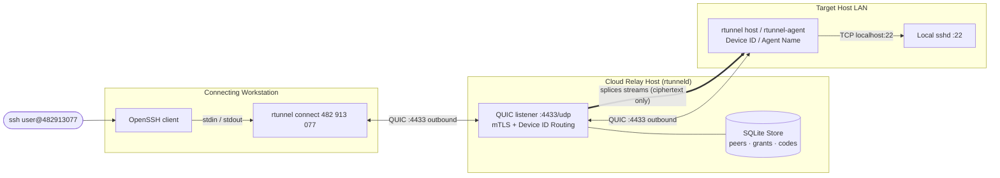
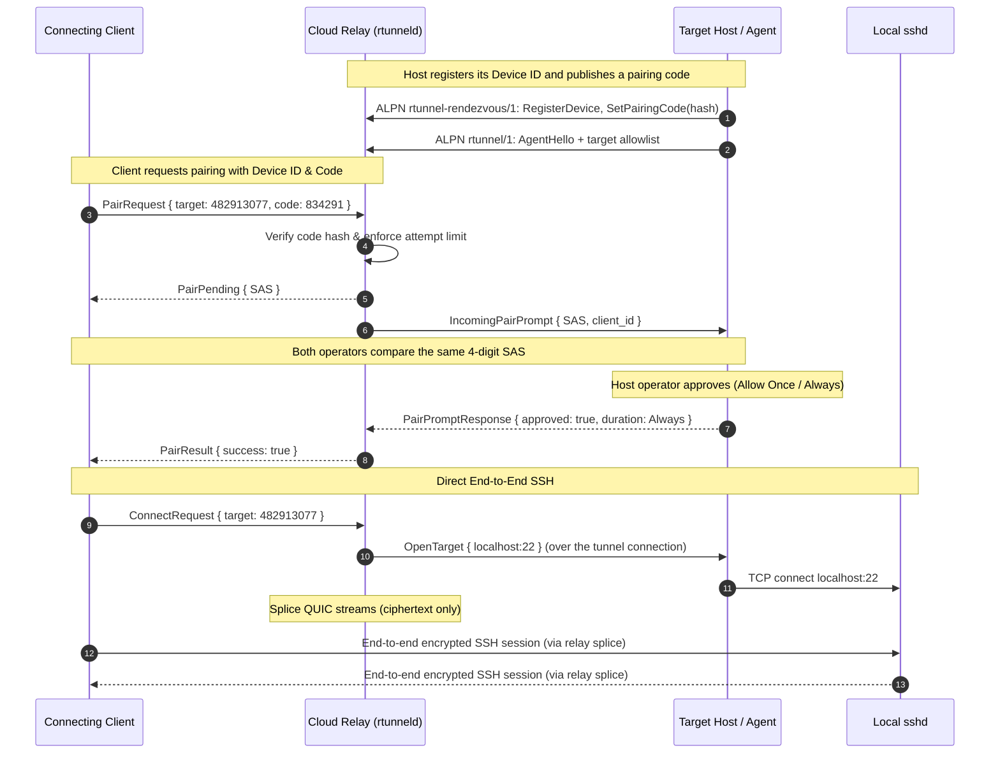

# rtunnel

`rtunnel` provides secure, zero-trust SSH access to machines located on private LANs without opening inbound firewall ports, configuring public NAT routes, or exposing public IPs.

- **AnyDesk-Style Experience**: Connect using a 9-digit Device ID (`482 913 077`) and an ephemeral 6-digit access code with interactive visual verification (SAS).
- **Dedicated Headless Agent (`rtunnel-agent`)**: Unattended daemon for servers, IoT devices, and bastion hosts with strict destination allowlists (`allowed_targets`).
- **Mutual TLS with Pinned ed25519 Identities**: No Certificate Authorities, passwords, or DNS-name trust.
- **End-to-End Encryption**: The relay only splices raw streams; SSH encryption remains strictly end-to-end between client and server.
- **Strict Default-Deny Authorization**: Explicit operator approval on the host or pre-authorized cryptographic tokens required before any connection is permitted.
- **Cross-Platform Host Support**: Runs as a managed service on Linux (`systemd`), macOS (`launchd`), and Windows (`sc.exe`).
- **Resilient Transport**: Multiplexed QUIC over UDP (`quinn`) with keepalives, dead-peer detection, exponential backoff, and full half-close fidelity.

---

## Architecture

`rtunnel` is a **rendezvous relay**, not a VPN. Both the connecting workstation and the remote host dial **outbound** to the cloud relay over QUIC/UDP. The relay authenticates both peers, checks authorization, and splices their streams together. The host or agent is the only component that dials the private target destination, and SSH encryption remains strictly end-to-end between the client's OpenSSH and the target's sshd.



### Pairing and Connection Lifecycle



---

## Workspace Layout

- `crates/proto`: Frame encoding, Postcard serialization, error codes, Device ID formatting, and SAS computation.
- `crates/identity`: ed25519 keys, X.509 SPKI fingerprint extraction, and custom rustls pinning verifiers.
- `crates/install`: Cross-platform background service installation (`systemd`, `launchd`, `sc.exe`) and OpenSSH configuration.
- `crates/transport`: QUIC endpoint builders, 32 KiB copy pumps, rate limiting, and backoff.
- `crates/relay`: `rtunneld` daemon, SQLite store (WAL mode), Device ID allocator, pairing coordinator, and audit log.
- `crates/agent`: `rtunnel-agent` headless daemon, TCP dialer with `TCP_NODELAY`, and target filtering.
- `crates/client`: `rtunnel` unified CLI, interactive host daemon, and OpenSSH `ProxyCommand` bridge.
- `tests`: Multi-peer integration tests covering Device ID pairing, transfer hash integrity, concurrency, half-close, and revocation.

---

## 1. Deploying the Cloud Relay (`rtunneld`)

The rendezvous relay (`rtunneld`) is the single cloud-facing component of the system. It runs on any Linux cloud instance or dedicated server with a publicly accessible IP or domain and an open UDP port (`4433` by default).

### 1.1 Firewall Prerequisites

Ensure UDP port `4433` is open for inbound traffic:

```bash
# UFW (Ubuntu/Debian)
sudo ufw allow 4433/udp
sudo ufw reload

# Firewalld (RHEL/Fedora/CentOS)
sudo firewall-cmd --permanent --add-port=4433/udp
sudo firewall-cmd --reload
```

### 1.2 Installation Options

#### Option A: One-Line Bootstrap Installer (Recommended)
The standalone installation script downloads the verified precompiled static binary (`musl`), initializes state in `/var/lib/rtunnel`, generates the relay's ed25519 identity keypair, writes the hardened `systemd` service unit, and starts the daemon immediately:

```bash
curl -fsSL https://raw.githubusercontent.com/abiiranathan/rtunneld/main/scripts/install.sh \
  | sudo bash -s -- relay --listen 0.0.0.0:4433
```

#### Option B: Direct Binary Self-Install
If you downloaded or built the `rtunneld` binary manually:

```bash
chmod +x rtunneld
sudo ./rtunneld install --listen 0.0.0.0:4433
```

Use `--no-start` to write the unit file without immediately enabling or starting the service.

#### Option C: Docker & Docker Compose
A production-ready `Dockerfile` and `docker-compose.yml` are provided in `deploy/`:

```bash
# 1. Initialize relay state and generate keypair
docker compose -f deploy/docker-compose.yml run --rm relay \
  /usr/local/bin/rtunneld init --state-dir /var/lib/rtunnel

# 2. Start the relay daemon
docker compose -f deploy/docker-compose.yml up -d relay
```

### 1.3 Verifying Relay Health & Audit Log

```bash
# Check systemd status
sudo systemctl status rtunneld.service

# View the real-time append-only security audit log
sudo tail -f /var/lib/rtunnel/audit.log
```

### 1.4 Upgrading an Existing Relay

Any relay used by `rtunnel setup` **must** run a build that supports
`rtunnel-rendezvous/1`. A relay from before the AnyDesk-style peer-discovery
release advertises only `rtunnel/1` and `rtunnel-enroll/1`; setup will fail with
a TLS/QUIC handshake error such as:

```text
relay TLS/QUIC handshake failed; verify --relay-fingerprint and ensure the
relay runs an rtunneld build that supports the rtunnel-rendezvous/1 ALPN
(upgrade the relay and restart it without deleting its state directory)
```

Upgrade the relay to the current release, then restart it. Re-running the relay
installer is safe: it reuses the existing identity in `/var/lib/rtunnel`, so the
relay fingerprint and all Device IDs, grants, and pairing codes are preserved.

```bash
# On the relay host; keep the same --listen value as the existing service.
# Add --state-dir too if the relay does not use the default /var/lib/rtunnel.
curl -fsSL https://raw.githubusercontent.com/abiiranathan/rtunneld/main/scripts/install.sh \
  | sudo bash -s -- relay --listen 0.0.0.0:4433

sudo systemctl status rtunneld.service
```

If you built `rtunneld` from source, run `sudo ./rtunneld install --listen 0.0.0.0:4433`
with the new binary instead. Do **not** delete `/var/lib/rtunnel` during an
upgrade.

After upgrading the relay, upgrade the `rtunnel` CLI on both endpoints too.
Current relay builds emit the protocol-minor-4 `PairPending` notice during
pairing, which older clients do not understand.

---

## 2. Quick Start: Connecting Two Machines (Under 3 Minutes)

> **Compatibility requirement:** the relay, the host machine, and the connecting
> workstation must all run the current build. In particular, the relay must
> support the `rtunnel-rendezvous/1` ALPN (protocol minor 4). Upgrading from an
> older release is covered in [Section 1.4](#14-upgrading-an-existing-relay).

### Step 0: Install the CLI on Both Endpoints

Install `rtunnel` on **both** the machine you want to reach (the host) and the
machine you will connect from:

```bash
# Linux / macOS
curl -fsSL https://raw.githubusercontent.com/abiiranathan/rtunneld/main/scripts/install.sh \
  | bash -s -- client
```

```powershell
# Windows PowerShell, from a cloned checkout
.\scripts\install-client.ps1
```

On Windows without a checkout, download `rtunnel-x86_64-pc-windows-msvc.zip`
from the GitHub releases page, extract `rtunnel.exe`, and place it on `PATH`.

The installer places `rtunnel` in `/usr/local/bin` when run as root,
`~/.local/bin` for normal users, and `%LOCALAPPDATA%\Programs\rtunnel` on
Windows. Make sure that directory is on your `PATH` before continuing.

### Step 1: Run Setup on Both Endpoints

Run setup **once on each endpoint** (host and workstation). Replace
`relay.example.com` with your relay's address:

```bash
rtunnel setup --relay-host relay.example.com
```

```powershell
# Windows PowerShell
rtunnel.exe setup --relay-host relay.example.com
```

If the relay listens on a non-default UDP port, add `--relay-port <port>`. To
pin the relay identity explicitly, add `--relay-fingerprint <sha256>`; otherwise
setup uses Trust On First Use (TOFU) and prints the fingerprint it pinned.

Setup generates an ed25519 keypair, connects over `rtunnel-rendezvous/1`, and
assigns a permanent 9-digit **Device ID** (for example `482 913 077`). It also
adds the rtunnel snippet directory to `~/.ssh/config`, but it does **not** write
any host entries yet. Note the Device ID printed on the host machine; you need
it to connect.

### Step 2: Start the Host (Remote LAN Machine)

On the machine you want to access:

```bash
rtunnel host
```

`rtunnel host` listens for pairing prompts and serves SSH to the local target,
which defaults to `127.0.0.1:22`. Use `--target host:port` to expose a different
local destination:

```bash
rtunnel host --target 127.0.0.1:22
```

It prints the Device ID and a single-use 6-digit access code:

```text
=== rtunnel Host Daemon Running ===
Device ID:   482 913 077
Access Code: 834 291 (valid for 15 minutes)
Allowed target: 127.0.0.1:22
Ready for inbound connections. Press Ctrl+C to exit.
```

The relay consumes a code as soon as one client uses it. The host automatically
prints a replacement code after every pairing attempt and before the 15-minute
TTL expires, so keep watching the host terminal for the current value.

Keep this process running while you connect. After granting a client `Always
Allow`, you can install it as a background service (which cannot answer new
pairing prompts); see [Host Service Installation](#3-host-service-installation).

### Step 3: Connect and Approve Pairing

On the workstation, connect through OpenSSH using `rtunnel connect` as the
`ProxyCommand`. This is a one-step pairing connection:

```bash
ssh -o "ProxyCommand=rtunnel connect 482913077 --code 834291" user@482913077
```

`rtunnel connect` is a transparent stdin/stdout bridge to the remote SSH port.
It is normally launched by OpenSSH as a `ProxyCommand`; running it by itself in
a terminal does not start an interactive shell.

While the connection is pending, the workstation prints the SAS it expects:

```text
PAIRING REQUEST SENT
Authentication Code (SAS): [4192]
Confirm this matches the code shown on the host.
```

The host prompts its local operator:

```text
--------------------------------------------------
INCOMING PAIRING REQUEST
Connecting Device: nathan-macbook (914 205 183)
Authentication Code (SAS): [4192]
Verify this code matches the one on the connecting device.
--------------------------------------------------
Authorize this device? [1] Allow Once, [2] Always Allow, [3] Deny:
```

The two SAS values **must match exactly**. Approval choices are:

| Choice | Effect |
| --- | --- |
| `1` — Allow Once | Authorizes this client in relay memory for 5 minutes. Nothing is persisted; a later connection needs a new access code and approval. |
| `2` — Always Allow | Persists the grant in the relay's SQLite store. Later connections need neither an access code nor a pairing prompt until the grant is revoked. |
| `3` — Deny (or any other input) | Rejects the request. |

After approving with `2` (Always Allow), write an OpenSSH host entry so plain
`ssh` works:

```bash
rtunnel ssh-config 482913077 --write
ssh user@482913077
```

To refresh entries for every device you have been granted:

```bash
rtunnel ssh-config --all --write
```

To inspect the generated configuration without writing it:

```bash
rtunnel ssh-config 482913077
```

With an "Allow Once" grant, the SSH snippet still works, but only for five
minutes. After it expires, pair again with `--code` (or choose Always Allow).

---

## 3. Host Service Installation

`rtunnel host` must stay running to accept pairings and serve sessions. You can
run it as a managed background service, but a service has **no interactive
terminal** and therefore cannot answer new pairing prompts. Install the service
only after at least one client has been granted **Always Allow**:

1. Stop the service if it is already running.
2. Run `rtunnel host` in a terminal and approve the client with `2` (Always Allow).
3. Start the service again. The persisted grant remains valid.

To approve a new device later, stop the service, repeat the foreground pairing
step, and start the service again.

### 3.1 Use the Right State Directory

Service managers run commands as `root`, `Administrator`, or a system account,
whose default configuration directory is **not** the one created by your
`rtunnel setup`. Always pass the state directory printed by setup (or by
`rtunnel id`) explicitly. Add `--target host:port` to the install command if the
service should dial a destination other than `127.0.0.1:22`.

```bash
# Run as the user who performed setup. Note the "State directory:" line.
rtunnel id
```

### 3.2 Linux (`systemd`)

```bash
# Replace the path with the one printed by 'rtunnel id'.
sudo rtunnel --state-dir "$HOME/.config/rtunnel" service install
```

The default state directory on Linux is `~/.config/rtunnel` when
`XDG_CONFIG_HOME` is unset.

### 3.3 macOS (`launchd`)

```bash
# Replace the path with the one printed by 'rtunnel id'.
sudo rtunnel --state-dir "$HOME/Library/Application Support/com.rtunnel.rtunnel" \
  service install
```

### 3.4 Windows (`Windows Service`)

Run PowerShell as Administrator. Replace the path with the one printed by
`rtunnel.exe id`:

```powershell
rtunnel.exe --state-dir "C:\Users\<you>\AppData\Roaming\rtunnel\rtunnel\config" service install
```

### 3.5 Managing the Service

```bash
# Linux / macOS
sudo rtunnel service start
sudo rtunnel service stop
```

```powershell
# Windows (Administrator PowerShell)
rtunnel.exe service start
rtunnel.exe service stop
```

---

## 4. Deploying the Headless Agent (`rtunnel-agent`)

For unattended servers, automated CI/CD runners, bastion hosts, or air-gapped infrastructure where interactive host-side pairing prompts (`rtunnel host`) are impractical, use the dedicated **`rtunnel-agent`** daemon.

The agent runs as a hardened systemd service, dials outbound to the relay over QUIC, and enforces a strict local destination allowlist (`allowed_targets`). It will refuse any connection to destinations not explicitly configured, protecting your internal LAN against SSRF.

### 4.1 Prerequisites: Generate an Agent Token

On the relay host, issue an enrollment URI for the agent:

```bash
sudo rtunneld token create --role agent --name clinic-a \
  --relay-host relay.example.com --relay-port 4433 --ttl 15m
```

This outputs a single-use enrollment URI:
```text
Enrollment URI: rtunnel://relay.example.com:4433/?fp=<relay_fingerprint>&token=<token>
```

*(Alternatively, use `rtunneld pair` to issue agent and client tokens simultaneously; see [Section 5.1](#51-pairing-via-pre-shared-tokens).)*

---

### 4.2 Installation Options

#### Option A: One-Line Bootstrap Installer (Recommended)
Downloads the prebuilt agent binary, installs it to `/usr/local/bin`, writes `/etc/systemd/system/rtunnel-agent.service`, enrolls the agent, and starts the service:

```bash
curl -fsSL https://raw.githubusercontent.com/abiiranathan/rtunneld/main/scripts/install.sh \
  | sudo bash -s -- agent "rtunnel://relay.example.com:4433/?fp=<relay_fp>&token=<token>" \
    --allowed-target 127.0.0.1:22
```

If you have a cloned checkout:
```bash
sudo ./scripts/install-agent.sh "rtunnel://relay.example.com:4433/?fp=<relay_fp>&token=<token>" \
  --allowed-target 127.0.0.1:22
```

#### Option B: Direct Binary Self-Install
If you built or downloaded the `rtunnel-agent` binary manually:

```bash
chmod +x rtunnel-agent
sudo ./rtunnel-agent install "rtunnel://relay.example.com:4433/?fp=<relay_fp>&token=<token>" \
  --allowed-target 127.0.0.1:22
```

#### Option C: Pre-Installation without an Enrollment URI
To pre-bake `rtunnel-agent` into VM images, cloud-init scripts, or golden templates without immediately enrolling or starting the service:

```bash
# 1. Install binary and systemd unit without starting
sudo ./rtunnel-agent install --no-start --allowed-target 127.0.0.1:22

# 2. Later, when an enrollment URI is provided:
sudo rtunnel-agent enroll "rtunnel://relay.example.com:4433/?fp=<relay_fp>&token=<token>" \
  --allowed-target 127.0.0.1:22

# 3. Enable and start the service
sudo systemctl daemon-reload
sudo systemctl enable --now rtunnel-agent.service
```

#### Option D: Docker & Docker Compose
To run `rtunnel-agent` inside a container (e.g. adjacent to containerized services):

```bash
# 1. Enroll the agent inside the container volume
docker compose -f deploy/docker-compose.yml run --rm agent \
  /usr/local/bin/rtunnel-agent enroll "rtunnel://relay.example.com:4433/?fp=<relay_fp>&token=<token>" \
  --allowed-target "sshd-host:22"

# 2. Start the container daemon
docker compose -f deploy/docker-compose.yml up -d agent
```

---

### 4.3 Installation Flags & File Locations

`rtunnel-agent install` accepts the following options:

| Flag               | Default                  | Description                                                                                          |
| ------------------ | ------------------------ | ---------------------------------------------------------------------------------------------------- |
| `[uri]`            | *None*                   | Optional one-time enrollment URI. If supplied, the agent enrolls immediately before service start.   |
| `--allowed-target` | `127.0.0.1:22`           | Permitted `host:port` destination. Can be specified multiple times. The first target is the default. |
| `--bin-dir`        | `/usr/local/bin`         | Destination directory for the `rtunnel-agent` executable.                                            |
| `--state-dir`      | `/var/lib/rtunnel-agent` | Directory storing `identity.key`, `identity.crt`, and `config.toml`.                                 |
| `--no-start`       | `false`                  | Writes unit and copies binary without enabling or starting the systemd service.                      |

**Standard File Layout:**
- Binary: `/usr/local/bin/rtunnel-agent`
- Unit File: `/etc/systemd/system/rtunnel-agent.service`
- Configuration: `/var/lib/rtunnel-agent/config.toml`
- Identity Key & Cert: `/var/lib/rtunnel-agent/identity.key` (mode `0600`), `/var/lib/rtunnel-agent/identity.crt`

---

### 4.4 Managing Allowed Targets (`targets`)

The agent enforces an exact-match allowlist for targets it will dial. You can view or update these targets at any time without re-enrolling the agent:

```bash
# List currently configured targets (first is the default)
sudo rtunnel-agent targets list

# Append an additional target (e.g. a database or internal host)
sudo rtunnel-agent targets add 192.168.1.50:22

# Remove a target from the allowlist
sudo rtunnel-agent targets remove 127.0.0.1:22

# Replace the entire allowlist at once
sudo rtunnel-agent targets set 127.0.0.1:22 192.168.1.100:80 10.0.0.5:5432

# Apply changes by restarting the service
sudo systemctl restart rtunnel-agent.service
```

When connected to a modern relay, the agent automatically advertises its allowed targets upon reconnection so clients can discover them via `rtunnel agents` and `rtunnel ssh-config --all --write`.

---

### 4.5 Service Verification & Health Checks

Verify that the agent service is active and connected to the relay:

```bash
# Check service status
sudo systemctl status rtunnel-agent.service

# Inspect live logs (connection status, control session, session opens)
sudo journalctl -u rtunnel-agent.service -f
```

---

### 4.6 Standalone / Foreground Execution

For troubleshooting, network testing, or container entrypoints, run the agent in the foreground:

```bash
# 1. Enroll state directory
rtunnel-agent --state-dir /var/lib/rtunnel-agent enroll \
  "rtunnel://relay.example.com:4433/?fp=<relay_fp>&token=<token>" \
  --allowed-target 127.0.0.1:22

# 2. Run the connector loop
rtunnel-agent --state-dir /var/lib/rtunnel-agent run
```

---

## 5. Headless Client Setup & Administration

### 5.1 Pairing via Pre-Shared Tokens

To enroll both a headless agent and a client workstation in a single administrative step:

```bash
# On the relay host:
sudo rtunneld pair --agent clinic-a --client laptop \
  --relay-host relay.example.com --relay-port 4433
```

This atomically creates both single-use enrollment tokens and records the client-to-agent access grant in SQLite:
```text
Agent enrollment URI:  rtunnel://relay.example.com:4433/?fp=...&token=<agent_token>
Client enrollment URI: rtunnel://relay.example.com:4433/?fp=...&token=<client_token>
Granted 'laptop' access to 'clinic-a'.
```

Then install each component:

```bash
# 1. On the agent host:
sudo rtunnel-agent install "rtunnel://relay.example.com:4433/?fp=...&token=<agent_token>" \
  --allowed-target 127.0.0.1:22

# 2. On the client workstation:
rtunnel install "rtunnel://relay.example.com:4433/?fp=...&token=<client_token>"
```

---

### 5.2 Client Workstation Installation (`rtunnel install`)

`rtunnel install` installs the binary, sets up `~/.ssh/config` snippet loading, enrolls using the URI, and writes OpenSSH host aliases for every agent that has already been granted to this client:

```bash
# Unix (Linux / macOS)
rtunnel install "rtunnel://relay.example.com:4433/?fp=...&token=<client_token>"

# Windows (PowerShell)
.\scripts\install-client.ps1 "rtunnel://relay.example.com:4433/?fp=...&token=<client_token>"
```

If no grant exists yet, installation succeeds and prints a reminder. Once the
grant is approved, write the host entry explicitly:

```bash
rtunnel ssh-config --all --write
```

Then connect via standard OpenSSH:
```bash
ssh user@clinic-a
```

`rtunnel ssh-config --all --write` is also the command to re-run after new
grants are added or a device advertises new targets.

---

### 5.3 Manual Token & Grant Commands

If managing tokens and permissions individually:

```bash
# Create individual single-use tokens
sudo rtunneld token create --role agent --name clinic-a --ttl 15m --relay-host relay.example.com
sudo rtunneld token create --role client --name laptop --ttl 15m --relay-host relay.example.com

# Authorize or revoke client-to-agent access grants
sudo rtunneld grant add laptop clinic-a
sudo rtunneld grant remove laptop clinic-a
sudo rtunneld grant list

# List registered peers or immediately revoke an identity
sudo rtunneld peers list
sudo rtunneld revoke clinic-a
```

When a peer is revoked, all active tunnel sessions terminate within 5 seconds and future handshakes are rejected.

---

## 6. Security & Threat Model

1. **Short Authentication String (SAS)**: Prevents relay MITM attacks. Even if an untrusted or compromised relay operator substitutes public keys, the 4-digit verification code will mismatch.
2. **Brute-Force & Enumeration Resistance**: Ephemeral access codes are rate-limited with progressive lockout after 5 incorrect attempts, and codes expire after 15 minutes.
3. **Zero Plaintext Exposure**: The relay only copies ciphertext frames; SSH keys, passwords, and sessions remain strictly end-to-end encrypted.
4. **Default-Deny**: A Device ID alone never grants access. First contact requires an active access code and explicit operator approval. "Allow Once" grants are in-memory and expire after 5 minutes; only "Always Allow" persists a grant in SQLite.
5. **SSRF Defense-in-Depth**: `rtunnel-agent` restricts connections strictly to its local `allowed_targets` allowlist. Even a compromised relay cannot coerce the agent to dial arbitrary internal IPs.
6. **Strict File Permissions**: Identity private keys are stored with `0600` modes on Unix, and daemons refuse to run if key files are group- or world-readable.

---

## 7. Testing & Quality Assurance

Run the complete test suite:

```bash
# Check formatting
cargo fmt --check

# Strict pedantic lint checks
cargo clippy --workspace --all-targets -- -D warnings -W clippy::pedantic

# Cross-crate integration tests (Device ID pairing, SAS verification, transfer integrity, half-close, revocation)
cargo test --workspace --all-targets
```
